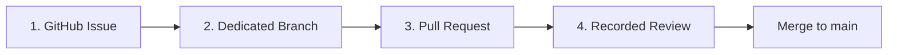

# Contributing to Mini Militia Modernization Workspace

First off, thank you for taking the time to contribute! :tada:

This repository is dedicated to reverse engineering, runtime modernization, and compatibility preservation of **Doodle Army 2: Mini Militia v4.2.8** for modern Android operating systems (Android 12, 13, 14, and 15).

All contributors are expected to uphold our [Code of Conduct](CODE_OF_CONDUCT.md).

---

## Table of Contents

- [The 4 Mandatory Workflow Rules](#the-4-mandatory-workflow-rules)
- [Prerequisites & Development Setup](#prerequisites--development-setup)
- [Repository Layout](#repository-layout)
- [Engineering Workflows](#engineering-workflows)
  - [1. Decompilation & Smali Patching](#1-decompilation--smali-patching)
  - [2. Native C++ Engine Modding](#2-native-c-engine-modding)
  - [3. Assembly, Alignment & Signing](#3-assembly-alignment--signing)
  - [4. Automated Deploy to Android Hardware](#4-automated-deploy-to-android-hardware)
- [Commit Message Conventions](#commit-message-conventions)
- [Verification & Quality Checklist](#verification--quality-checklist)

---

## The 4 Mandatory Workflow Rules

To maintain high technical quality and continuous integration integrity, this repository enforces a strict GitHub governance model:



### 1. Issue First
* **Never begin work without an issue.**
* Create an issue detailing the motivation, technical approach, and acceptance criteria using `gh issue create` or our GitHub Issue Forms.

### 2. Dedicated Branch
* **Direct pushes to `main` are strictly prohibited.**
* Always branch off an up-to-date `main` using descriptive prefix conventions:
  - `feature/<name>` : New capabilities, tooling, or architectural additions.
  - `mod/<name>` : In-game modifications, smali patches, or native engine tweaks.
  - `fix/<name>` : Bug fixes, build resolutions, or compatibility adjustments.
  - `docs/<name>` : Documentation, runbooks, or community standards updates.

### 3. Pull Request (PR)
* Open a PR against `main` using `gh pr create` or the GitHub interface.
* Always fill out the [Pull Request Template](.github/pull_request_template.md).
* Explicitly link the PR to the relevant issue using `Closes #<id>` or `Resolves #<id>`.

### 4. Recorded Code Review
* Every PR must undergo a formal code review recorded on GitHub.
* An approving review highlighting technical analysis and test verification must be logged before merging.

---

## Prerequisites & Development Setup

Our development toolchain is optimized for **Ubuntu Linux** (20.04 / 22.04 / 24.04 LTS or WSL2):

### 1. Install System Packages
```bash
sudo apt update
sudo apt install -y default-jdk openjdk-17-jdk apktool aapt zipalign adb python3 python3-pip git
```

### 2. Verify Toolchain
Ensure all command-line utilities are accessible in your `$PATH`:
```bash
java -version
apktool --version
zipalign --version
python3 --version
```

### 3. Setup Python Environment
All scripts in `scripts/` use standard Python 3 with zero external dependencies.

---

## Repository Layout

```
├── .github/                     # GitHub Issue Forms, PR templates, and CI workflows
├── .agents/skills/              # Antigravity agentic reverse engineering skills
├── scripts/
│   ├── build_and_deploy_apk.py  # End-to-end automated rebuild, sign, & ADB deploy
│   ├── extract_assets.py        # Sprite and asset decompression / extraction tool
│   └── patch_native_engine.py   # Binary patch engine for libcocos2dcpp.so
├── decompiled_app/              # Decompiled APK tree (manifest, smali, assets, res)
│   ├── AndroidManifest.xml      # Modernized manifest (Target SDK 33, exported flags)
│   ├── apktool.yml              # Build configuration and SDK definitions
│   ├── lib/armeabi-v7a/         # Native C++ game engine (libcocos2dcpp.so)
│   ├── res/                     # Layouts, values, drawables
│   └── smali/                   # Dalvik bytecode decompilation
├── dist/                        # Target output directory for built packages
├── keystore/                    # Cryptographic keystores for reproducible signing
├── mod_config.json              # Declarative native engine toggles
├── AGENTS.md                    # Agentic and developer governance rules
├── GEMINI.md                    # Core workflow constraints
├── LICENSE                      # Open-source MIT License & Disclaimer
├── README.md                    # Project documentation & releases runbook
└── SECURITY.md                  # Security policies and disclosure channels
```

---

## Engineering Workflows

### 1. Decompilation & Smali Patching
To decompile a clean target APK:
```bash
apktool d base.apk -o decompiled_app
```

When modifying smali bytecode:
* Maintain register allocation integrity (`.locals`, `.registers`).
* Ensure newly added methods do not overwrite existing virtual or direct method tables.
* Keep edits idempotent where possible.

### 2. Native C++ Engine Modding
The native game engine resides at `decompiled_app/lib/armeabi-v7a/libcocos2dcpp.so`.

Use our declarative patch engine via `mod_config.json`:
```json
{
  "unlocked_propack": true,
  "infinite_flying_power": false,
  "dual_wield_any_gun": false,
  "laser_sight_all_weapons": false,
  "unlimited_ammo": false,
  "unlimited_clip": false,
  "instant_reload": false,
  "game_run_in_background": false,
  "anti_gravity": false
}
```
Apply patches directly:
```bash
python3 scripts/patch_native_engine.py
```
*Note: A pristine backup (`libcocos2dcpp.so.original`) is always preserved to ensure idempotent zero-drift execution.*

### 3. Assembly, Alignment & Signing
Rebuild the workspace into an Android package:
```bash
# 1. Assemble unsigned APK
apktool b decompiled_app -o dist/app_unaligned.apk

# 2. 4-byte zipalign
zipalign -f -p -v 4 dist/app_unaligned.apk dist/app_aligned.apk

# 3. Cryptographic sign (v1, v2, v3 schemes)
apksigner sign --ks minimilitia-release.jks \
  --ks-key-alias minimilitia \
  --ks-pass pass:android123 \
  --key-pass pass:android123 \
  --out dist/MiniMilitia-Modernized-Release.apk \
  dist/app_aligned.apk
```

### 4. Automated Deploy to Android Hardware
Connect your physical device via USB or wireless ADB:
```bash
python3 scripts/build_and_deploy_apk.py
```
This script automatically executes the entire compilation, binary patching, alignment, signing, and direct ADB push/launch pipeline.

---

## Commit Message Conventions

We follow [Conventional Commits](https://www.conventionalcommits.org/):

* `feat:` A new feature or mod capability (e.g., `feat(engine): add 120 FPS high refresh toggle`).
* `fix:` A bug fix or runtime compatibility patch (e.g., `fix(manifest): add exported flag to DA2Activity`).
* `mod:` An in-game modification or bytecode tweak (e.g., `mod(smali): unlock pro pack features`).
* `docs:` Documentation improvements (e.g., `docs(readme): add releases catalog`).
* `chore:` Maintenance, refactoring, or tool updates (e.g., `chore(ci): update build validation action`).

---

## Verification & Quality Checklist

Before opening your Pull Request, verify:

- [ ] Code passes Python syntax checks (`python3 -m py_compile scripts/*.py`).
- [ ] `mod_config.json` is valid JSON and parses cleanly.
- [ ] APK compiles without Apktool assembler warnings or errors.
- [ ] APK is 4-byte aligned (`zipalign -c -v 4 dist/*.apk` returns `Verification successful`).
- [ ] APK signature is valid under schemes v1, v2, and v3 (`apksigner verify -v dist/*.apk`).
- [ ] Game successfully boots and launches into the main menu on Android 12, 13, 14, or 15.
- [ ] Local LAN multiplayer packet broadcast functions over Wi-Fi Hotspot.
