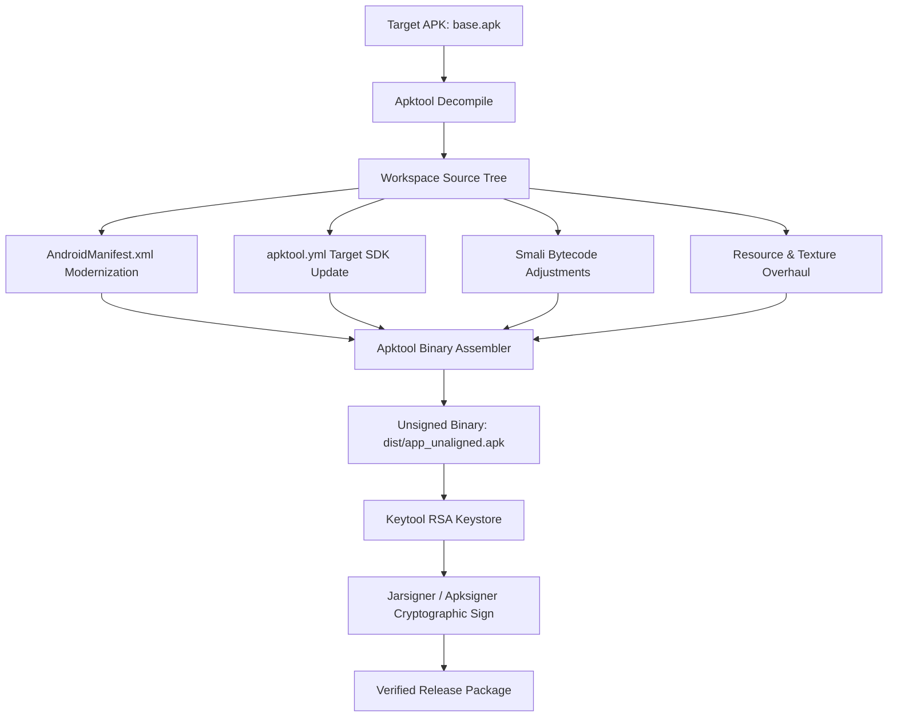

# Mini Militia (Doodle Army 2) Modernization Workspace

<p align="left">
  
  
  
  
  
  
</p>

An engineering workspace dedicated to the reverse engineering, modernization, and runtime compatibility preservation of **Doodle Army 2: Mini Militia v4.2.8**.

---

## 1. Technical Specifications

| Parameter | Baseline Value | Modernized Value | Notes |
| :--- | :--- | :--- | :--- |
| **Package Name** | `com.appsomniacs.da2` | `com.appsomniacs.da2` | Preserved for local LAN discovery |
| **Version Name** | `4.2.8` | `4.2.8` | Classic Appsomniacs golden era |
| **Version Code** | `265` | `265` | Native build identifier |
| **Target SDK** | `26` (Android 8.0) | `33` (Android 13.0) | Prevents modern OS install blocks |
| **Minimum SDK** | `16` (Android 4.1) | `16` (Android 4.1) | Full backward compatibility |
| **Display Aspect** | `2.1` (Max Aspect) | `2.4` + Resizable | Edge-to-edge support for 20:9 displays |
| **Cleartext Traffic** | System Default (Blocked) | `true` (Explicit) | Allows local Wi-Fi Hotspot LAN play |
| **Exported Components** | Implicit | Explicit (`true` / `false`) | Android 12+ security standard compliance |
| **Native Engine** | Cocos2d-x (C++) | Cocos2d-x (C++) | `libcocos2dcpp.so` (12.8 MB) |
| **Native Architecture** | `armeabi-v7a` (32-bit ARM) | `armeabi-v7a` (32-bit ARM) | Requires 32-bit compatible hardware/ROM |

---

## 2. Modern Android Compatibility Patches

Legacy APK builds compiled for Android 8 fail during installation or runtime on modern operating systems (Android 12, 13, 14, and 15). The following structural patches have been applied directly to the decompiled manifest and package metadata:

### A. Android 12+ Explicit Component Export
Android 12 (API level 31) introduced a mandatory requirement that any activity, receiver, or service containing an `<intent-filter>` must explicitly declare `android:exported="true"` or `android:exported="false"`. Failure to declare this attribute results in `INSTALL_PARSE_FAILED_MANIFEST_MALFORMED`.
* Patched `com.appsomniacs.da2.MiniMilitiaActivity` to `android:exported="true"`.
* Patched `com.appsomniacs.da2.DA2Activity` to `android:exported="true"`.
* Patched `com.tapjoy.TapjoyReceiver` to `android:exported="false"`.

### B. Local Wi-Fi Hotspot & Socket Communication
Android 9 (API level 28) disabled cleartext network traffic by default. Because Mini Militia v4.2.8 utilizes standard local UDP/TCP broadcast packets for local Wi-Fi multiplayer, modern devices block session discovery.
* Enabled `android:usesCleartextTraffic="true"` within `<application>`.

### C. Ultra-Wide Display Scaling
Modern smartphone displays utilize 19.5:9 and 20:9 aspect ratios. The legacy metadata `android.max_aspect="2.1"` forced letterboxing (black bars on lateral borders).
* Increased `android.max_aspect` to `2.4`.
* Enabled `android:resizeableActivity="true"`.

### D. Runtime Library Resolution
* Injected `<uses-library android:name="org.apache.http.legacy" android:required="false"/>` to prevent class-not-found exceptions on modern runtimes.

---

## 3. Engineering & Rebuild Pipeline



---

## 4. Compilation and Signing Runbook

### Prerequisites
Ubuntu Linux toolchain:
```bash
sudo apt update
sudo apt install default-jdk openjdk-17-jdk apktool aapt -y
```

### Step 1: Decompilation
```bash
apktool d base.apk -o decompiled_app
```

### Step 2: Binary Reassembly
Rebuild the workspace into an unaligned APK package:
```bash
mkdir -p dist
apktool b decompiled_app -o dist/MiniMilitia-ModernAndroidCompatibility-1.apk
```

### Step 3: Cryptographic Signing & Alignment
Modern Android operating systems (Android 11 through 15) strictly enforce 4-byte uncompressed alignment for `resources.arsc` and require APK Signature Scheme v2 or v3. Use `uber-apk-signer` (or `zipalign` + `apksigner`):

```bash
# Production Signing and 4-byte Page Alignment
uber-apk-signer -a dist/MiniMilitia-120FPS-StatsDisplay-3.apk \
  --ks minimilitia-release.jks --ksAlias minimilitia \
  --ksPass android123 --ksKeyPass android123 \
  --allowResign --overwrite --verbose
```

---

## 5. Releases and Verified Artifacts

| Attempt | Release Tag | Binary Name | Status / Highlights | SHA-256 Hash |
| :--- | :--- | :--- | :--- | :--- |
| **Attempt 1** | `v4.2.8-compat.1` | `MiniMilitia-ModernAndroidCompatibility-1.apk` | Initial Target SDK 33 update (Missing v2/v3 signature & zipalign) | `789ad38a4f5810df0f891b909ae5fa55e73f13ec27f62678dbd50be2283e7e21` |
| **Attempt 2** | `v4.2.8-compat.2` | `MiniMilitia-ModernAndroidCompatibility-2.apk` | Resolved Android 11-15 install (4-byte zipalign + v1, v2, v3 signed) | `63f2b8d94db21e5dedae7ee882d3a5ad9b710c3640b78f9f19a1ef3d924d9875` |
| **Attempt 3** | `v4.2.8-fps.3` | `MiniMilitia-120FPS-StatsDisplay-3.apk` | Unlocked 120 FPS high refresh rate + Live in-game FPS HUD overlay | `90b890524ecb8c8d748d6dd12966800b15945b97cead34bffbba457b4c9a9822` |
| **Attempt 5** | `v4.2.8-family-dev.5` | `MiniMilitia-Dev-Family-5.apk` | Permanent Pro Pack unlock, top-left Dev module with bio and Facebook link, top-right Family roster dialog, 120 FPS Settings toggle, permanent release keystore | `61cea9aca0aaa4102d0bd1287a1be529382651bd3c0ea90fcc9d341307b86541` |

Download the verified prebuilt packages directly from [GitHub Releases](https://github.com/MikeeeDeV/apk-project/releases).

---

## 6. Open-Source LAN Remake (Catacombs Edition)

A 100% open-source, easily customizable recreation of Mini Militia (Doodle Army 2) built from extracted APK assets, designed for **instant local multiplayer (LAN / Wi-Fi Hotspot)** across PC, Android, and iOS browsers.

### Features
* **Zero Compilation Barrier**: Connect friends immediately over local Wi-Fi / Hotspot via browser at `http://<LAN-IP>:3000`.
* **Authentic Physics & Controls**: Jetpack flight propulsion, dual-stick touch controls for mobile, and mouse/keyboard for desktop.
* **Catacombs Map**: Authentic collision geometry and spawn points parsed directly from `11catacombs_new.tmx`.
* **Authentic Audio & Textures**: Sliced weapon sprites (AK-47, Shotgun, Sniper, SMAW Rocket, Uzi, Desert Eagle, Frag Grenades) and 111 authentic audio effects extracted from `da2sound16.ckb`.
* **Complete Moddability**: All weapons (`remake/config/weapons.json`) and physics (`remake/config/game_config.json`) stored in plain JSON, with a live in-game Modding Drawer (`⚙️`).
* **Godot 4 Architecture**: Complete 2D project with GDScripts included in `remake/godot_project/`.

### Runbook
```bash
cd remake
npm install
npm start
```
For complete customization instructions, see the [Modding Guide](remake/MODDING_GUIDE.md).

---

## 7. Repository Governance & Workflow Standards

This repository enforces strict GitHub engineering standards across all contributions:

1. **Issue Tracking**: Every modification or feature requires an initial GitHub Issue tracking scope, technical approach, and acceptance criteria.
2. **Dedicated Branching**: Direct pushes to `main` are restricted. All development occurs on isolated branches (`feature/*`, `mod/*`, `fix/*`, `docs/*`).
3. **Pull Request Protocol**: Merging requires an explicit Pull Request referencing the corresponding issue with `Closes #<id>`.
4. **Recorded Code Review**: Every Pull Request must record a documented peer code review on GitHub with technical verification before merge approval.

